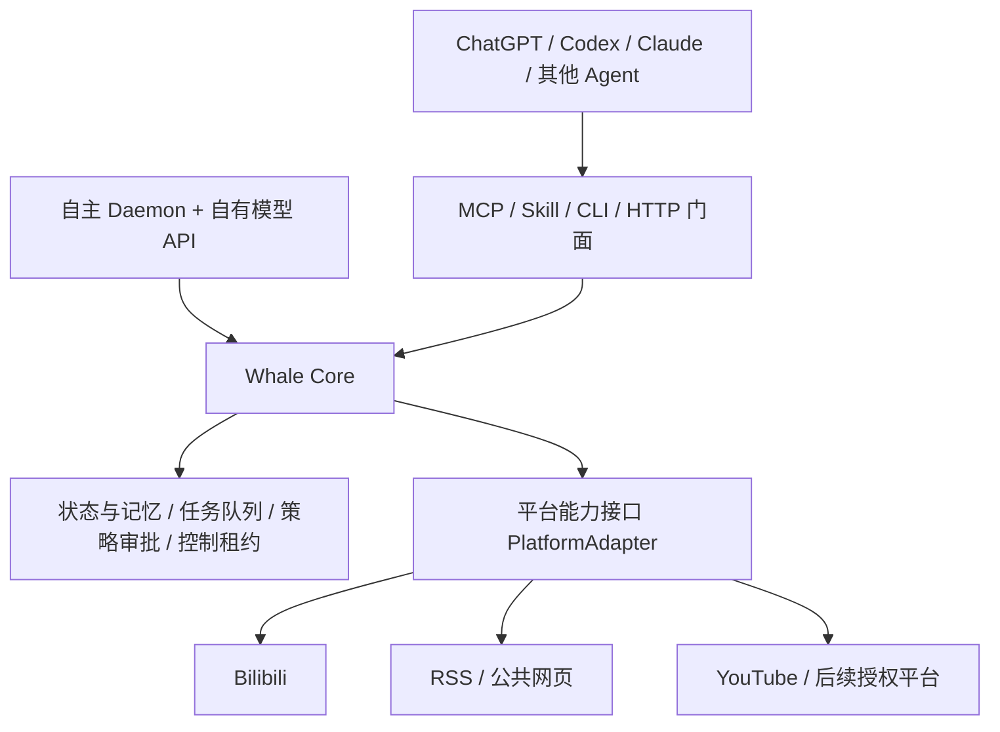

# Whale Agent：基于 dsh-bili-whale 的跨 Agent / 跨平台重构方案

> 方案版本：v1.0（设计稿）  
> 编制日期：2026-10-28  
> 状态：持续开发中；P0/P1 已完成，P2 双平台 MCP/Skill 已实现，P3 固定大脑 Daemon 与 C 模式外部 Agent 控制租约首版已实现；当前持续进行端到端回归与可靠性收敛  
> 上游：[Alterssss/dsh-bili-whale](https://github.com/Alterssss/dsh-bili-whale)  
> 基线：`v0.4.6`，`main@8b0009f8ce2ebdc421afcb2e727b19ac18912ec6`（2026-10-25）

## 0. 结论与产品边界

采用 **个人 Fork + 长期产品分支**，不是在原作者仓库直接建分支。推荐工作名称 **Whale Agent**；正式命名和仓库名称以后确定。

目标是基于原项目既有“有日子的鱼”设计与 B 站能力，建设一套**独立运行的 Agent 运行时**：

1. 自主模式：进程常驻，由自身模型 API、调度器与记忆系统运作，不依赖某个聊天窗口常开。
2. 协作模式：支持 MCP 的 ChatGPT、Codex、Claude Code 或其他 Agent，能够查看、提议、操作和临时接管同一只 Whale；没有 MCP 的宿主通过 CLI/受控 HTTP 适配。
3. 平台模式：B 站从“全系统唯一平台”变成 `BilibiliAdapter`；其余平台通过能力声明的 `PlatformAdapter` 接入，不以平台名称为条件写死业务规则。
4. 持久人格与记忆：不同 Agent 使用**同一套状态、人格、记忆、行动账本**；模型变化可以造成表达差异，但不会创造互不相识的独立“鱼”。
5. 保留原核心体验：随机生物钟、按偏好挑内容、深读多模态素材、两本日记、有限度的自主分享、反馈与沉默衰减、回复审核和风控。不是所有宿主都需要复制 DSH 的原设置页。

**非目标**：无条件登录任何网站、突破验证码/风控、替没有权限的账户发帖、将 Skill 当成后台守护进程、无授权地跨账号群发、把任意网站解析器当成合法可写 API。

## 1. Fork、分支与许可证策略

原仓库当前公开、MIT，GitHub 连接对上游无写权限。建议：

```text
Alterssss/dsh-bili-whale [upstream/main]  ← 原作者持续维护
                 │ Fork
个人账号/dsh-bili-whale [origin/main]      ← 尽量只同步上游
                 └── [origin/agent-main]   ← 新产品长期稳定线
                      ├── feature/core-runtime
                      ├── feature/platform-contract
                      ├── feature/mcp-server
                      └── feature/agent-handoff
```

- 上游 `main` 不直接承载重构；新功能通过 `feature/*` PR 合入 `agent-main`；准备发布后把 Fork 的默认分支切到 `agent-main`。
- 固定上述基线 SHA，并打内部 baseline tag；CI 保存基线测试报告。**不要在未建基线时大规模移动源码。**
- 定期 `fetch upstream`，先评估再选择性 cherry-pick B 站 API 与安全修复；重构后不承诺能一键合并上游全部提交。
- 保留原 `LICENSE` 与版权声明（`Copyright (c) 2026 ALTERSSSS`）；新增文件可单列新版权。审视 `NOTICE.md`：`tools/docs/` 中的第三方接口资料需单独核实其许可，不随意重新分发；FFmpeg 不直接打包，另循其许可证。
- 仓库在获得用户明确授权后才创建；这份设计不实施外部写操作。

## 2. 源码现状与改造映射

| 上游位置 | 已有价值 | 当前耦合/问题 | 目标归属 |
|---|---|---|---|
| `lib/index.js`、`lib/client.js` | 配置、凭据管理、审核、二维码登录、设置页面 | DSH `webServer`/`connection` 注入与其浏览器模块绑定 | `adapters/host-dsh`（兼容可选）、新管理 UI、`core/config` |
| `lib/scheduler.js`、`lib/session-delivery.js` | 生物钟、监听、唤醒提示、会话入队、去重投递 | 直接依赖 `ctx.sessionController.prompt`、DSH session 文件及定时器 | `runtime/scheduler`、`runtime/worker`、`runtime/controllers` |
| `tools/bili.mjs`、`tools/commands/*` | B 站搜索、推荐、深读、评论、私信、弹幕、日记和额度 | 绝大部分是可执行 CLI，参数与 `stdout` 耦合；各脚本直连 B 站 | 保留兼容 CLI；逐步抽出返回结构化数据的服务函数 |
| `tools/lib/bili-api.mjs`、`lib/auth.js` | WBI、接口缓存、扫码登录 | B 站专有协议 | `platforms/bilibili` |
| `tools/lib/traffic.mjs`、`tools/commands/quota.mjs` | 请求限速、封禁退避、未知发送状态、分享额度 | 状态按 B 站账户/目录组织；部分限制散落在命令中 | `core/policy` + 平台专用风险策略 |
| `tools/lib/config.mjs`、`tools/commands/diary.mjs` | 用户偏好、人格设置、日记与事件流 | `~/.dsh` 和 `~/.bili-ai` 文件依赖；部分逻辑解析 Markdown | `core/storage`、`core/memory`，保留 Markdown 导出 |
| `tools/commands/debrief.mjs`、`ffmpeg.mjs` | 字幕、评论、弹幕、抽帧综合理解 | 视频元数据/下载来源和 B 站 ID 深度绑定 | `core/media` + `platforms/bilibili` 获取器 |
| `tests/*.test.mjs` | 回归基线 | 偏向 DSH 与 B 站接口行为 | 保留原测试，增加适配器契约和跨 Agent 集成测试 |

特别注意：只包一层 MCP、再调用 `node tools/bili.mjs ...` **可以是短期兼容桥**，不能是长期架构。后者由子进程、自由格式输出、硬编码路径和隐式副作用组成，难以保证跨宿主的一致性与写操作安全。

## 3. 目标逻辑架构



### 核心模块

- `AgentOrchestrator`：拆成「发现内容→观察与取证→总结→决策→拟稿→政策审核→执行→复核→写日记」，每步有清晰输入、输出、失败状态与预算。
- `ModelRouter`：可配置 OpenAI、DeepSeek、Anthropic、Gemini、Ollama/本地模型等提供方；提供统一 `generateStructured()` 和 `analyzeMedia()`，按实际模态能力选择，失败降级不能捏造已看过的内容。具体提供方以实际 API 可用性为准。
- `PlatformRegistry`：发现、注册、验证、启停适配器，并公布运行时能力和权限。
- `PolicyEngine`：不可由提示词覆盖的限速、平台权限、额度、对象白名单、二次确认、停机开关、操作去重。
- `MemoryStore`：人格、长期事实与来源、偏好、关系、事件记忆、两类日记，提供检索和可追溯修订。
- `Scheduler/Worker`：作息、监听、重试、维护计划，重启后恢复；记录任务状态，不能仅依赖聊天宿主运行的内存定时器。
- `EventLog/Outbox`：外部动作的唯一出口，统一审计、幂等标识、未知结果核对和通知。

## 4. 平台适配器契约（最重要的扩展边界）

每个平台声明自己**实际能做什么**，不实现的能力要显式返回 `unsupported`，而不是通过伪接口兜底：

```ts
type Capability =
  | 'search' | 'feed.read' | 'content.read' | 'media.analyze-input'
  | 'comments.read' | 'comments.write' | 'messages.read'
  | 'messages.write' | 'content.publish' | 'live.read';

interface PlatformAdapter {
  id: string;                        // bilibili, rss, youtube ...
  getCapabilities(accountId?: string): Promise<Capability[]>;
  connect(input: AuthRequest): Promise<AccountConnection>;
  search?(q: SearchQuery): Promise<ContentPage>;
  feed?(q: FeedQuery): Promise<ContentPage>;
  getContent?(id: PlatformContentId): Promise<ContentItem>;
  getDiscussion?(id: PlatformContentId): Promise<DiscussionPage>;
  pollEvents?(cursor?: string): Promise<EventBatch>;
  prepareAction?(draft: ActionDraft): Promise<ActionPreview>;
  executeAction?(approved: ApprovedAction): Promise<ActionReceipt>;
  reconcileAction?(receipt: ActionReceipt): Promise<ActionStatus>;
}
```

规范化对象应至少包含：`platform`、`accountId`、`externalId`、`canonicalUrl`、`kind`、`creator`、`publishedAt`、`contentSegments`（文本/字幕/图像/许可可获取的媒体）、`discussionRefs`、`provenance`。推荐键为 `platform:externalId`，不能把所有内容硬塞进 B 站 `BV` 编码模型。

平台能力范围（按计划，非声称已实现）：

| 平台 | 优先读取能力 | 可能写入的能力 | 门槛 |
|---|---|---|---|
| **B 站** | 视频、搜索、弹幕、字幕、评论、动态、直播弹幕 | 评论、回复、指定对象私信、动态等原已实现功能 | 当前大量接口为非官方接口；维护风险、风控、账号授权 |
| **RSS/Atom** | 订阅、文章正文、更新追踪 | 无，默认只读 | 最适合作为第二适配器，证明平台抽象不是 B 站专用 |
| **公共网页** | 合规可访问的页面、元数据、链接 | 默认无 | robots/使用条款、登录授权、版权、页面变化 |
| **YouTube** | 元数据、搜索、公开评论 | 已授权账户可用的评论/回复等 | Google OAuth 与 API 配额；并不意味着任意视频均可合法获取字幕或文件 |
| **抖音/小红书/其他** | 后续逐站调研 | 仅开放且明确授权的接口 | 不保证有可用开放 API，不绕过反爬与风控 |

扩展流程：开发者创建一个插件包 → 声明 capability、auth 和 scopes → 通过 `adapter-contract` 测试 → 由使用者安装并单独授权 → Runtime 自动发现，不改核心业务。**“任意支持接入的站点”指可合法获取必要接口权限且通过契约测试的站点，而非所有网站一键启用全部功能。**

## 5. 双脑兼容（用户已选择 C）

| 模式 | 决策者 | 触发机制 | 记忆与执行 |
|---|---|---|---|
| `autonomous` 自主 | 自己配置的模型提供方（可选固定/回退模型） | Daemon 生物钟、订阅事件 | 统一 Core、MemoryStore、PolicyEngine |
| `delegated` 外部 Agent 协作 | ChatGPT/Codex/Claude 等调用方模型 | 使用者在宿主聊天中发出任务，Agent 调用 MCP | **相同** Core 与状态，不创建另一条人格分叉 |
| `manual` 用户接管 | 人类审核/直接下达意图 | 管理面板或 CLI | 同样经过权限与审计；高风险操作仍需显式确认 |

**接管不能靠一段提示词约定。**定义 `control_lease`：`holder`、`scope`、`expiresAt`、`heartbeat`、`revokedAt`。外部 Agent 申请写控制权后，Daemon 可继续只读收集，但暂停冲突的自主写入；租约超时/显式释放后恢复。所有平台写入经 `PolicyEngine` 与 `ActionOutbox`；租约不能豁免权限策略。多 Agent 并发应由单写者队列、账号级锁与数据库唯一约束处理。

外部 Agent 并非被平台“远程切换成内部模型”：它只在主动连接、获得授权、调用工具时参与决策。无人调用时仍由 Daemon 的自有模型承担自主工作。自有模型 API 的费用、密钥和会话均与 ChatGPT 订阅/聊天记录分开。

## 6. MCP、Skill、CLI 三种交付

1. **MCP Server**（操作能力）：`stdio` 供本地 Agent 使用；认证后的 `Streamable HTTP` 供远程、Web 与移动端宿主使用。两种传输共享一套服务函数；按宿主支持的 MCP 协议协商版本。
2. **Agent Skill**（使用约定）：标准 `skills/whale-agent/SKILL.md`，写明什么时候查询、怎样接管、何时必须审核、如何恢复暂停，引用 `references/`；它不存 Cookie、不运行独立调度器。
3. **CLI/受控 HTTP**（兜底）：不支持 MCP 的宿主使用 `whale status|run|diary|...` 或授权 API；原 `bili.mjs` 可临时作为兼容别名。

建议 MCP tools（工具集后续可合并，避免暴露过多）：

| 类别 | Tool | 基本行为 |
|---|---|---|
| 观察 | `whale.status`、`whale.platforms`、`whale.accounts` | 只读，运行状态/能力/授权范围 |
| 读取 | `whale.search`、`whale.read`、`whale.diary`、`whale.memory_query` | 返回带来源的标准对象 |
| 运行 | `whale.plan`、`whale.run_once`、`whale.job_status` | 异步作业返回 `jobId`，可查询而不是要求一次调用长时间阻塞 |
| 操作 | `whale.draft_action`、`whale.approve_action`、`whale.action_status` | 预览、审批、单次提交、审计与不确定状态处理 |
| 控制 | `whale.acquire_control`、`whale.release_control`、`whale.pause` | 有权限的接管/释放/紧急停止 |

发布为可安装 Agent Plugin 时，生成符合宿主要求的 `plugin.json`、`mcp.json`、Skill 文件及可选 App UI。**不承诺所有 Agent 自动支持同一种打包格式**；标准化的是协议与核心行为，宿主配置由适配层解决。

## 7. 存储、记忆与旧数据迁移

建议单机第一版使用 **SQLite + WAL + 版本化 migrations**，未来云端以 PostgreSQL 替换 repository interface。Markdown 是**导出/阅读视图**，不再是唯一真相。

最小数据表（可按实现合并）：

- `whales` / `personas`：实例、人格版本、用户自定义底线。
- `accounts` / `credentials_ref`：平台账户、权限范围和安全凭据引用，不明文暴露给 Agent。
- `content_items` / `observations`：内容索引、摘要、帧/字幕/评论引用、来源证据与获取时间。
- `memories` / `preferences` / `relationships`：长期事实、来源、信心、偏好变更及关系映射。
- `diary_entries`：给主人的信、给自己的日记，区别事实和感想；能追溯生成依据。
- `jobs` / `schedule_windows` / `event_cursors`：运行记录、作息、已消费事件游标。
- `action_outbox` / `approvals` / `leases` / `audit_events`：外部写入防重、授权、控制权及不可否认审计。
- `rate_state` / `platform_health`：平台/账户/接口级别的预算、暂停及封禁状态。

统一 ID：`whaleId + platformId + accountId + externalId`；对写动作附唯一 `idempotencyKey`。账号或平台变更不应错误复用另一站点的 `owner.mid`。支持多实例，但 v1 默认单 Whale/用户以降低风险。

**迁移流程**：

1. 只读扫描旧文件：`~/.dsh/bili-whale.config.json`、`~/.dsh/whale-diary.md`、`~/.dsh/whale-log.jsonl`、`~/.bili-ai/` 的凭据、额度、反馈、待审批草稿和历史等。生成迁移预览及字段映射。
2. 备份原始文件（包含敏感数据，限制文件权限、不入 Git、不上传报告）；先模拟导入并校验条数、去重和内容映射。
3. 正式导入用事务和版本标记；旧数据保留原地不删除，`migrate --dry-run` 与重复执行均安全。旧人格和两本日记可保留 Markdown 原文与来源链接。
4. **先停止旧 DSH 调度与写监听，再启用新 Daemon 对同一账户的写能力。** 禁止两套服务同时拿同一 Cookie 自主发帖；迁移首日默认只读观察。
5. 回滚时停新服务、恢复旧服务；不要回滚已执行的外部评论/私信，需用 `action_outbox` 核对并阻止重发。

## 8. 安全策略与可靠性设计

- **最小权限**：新的 MCP 工具不获得 shell 完全权限；删除“完全访问才会工作”的部署前提。媒体处理 subprocess 仅运行受限 `ffmpeg` 等许可程序，不执行模型生成的任意命令。
- **内容不可信**：视频字幕、弹幕、评论、网页、私信属于数据而非系统指令；在模型上下文分区标识来源，工具调用参数必须再由服务端鉴权、验证。
- **认证与凭据**：B 站维持独立二维码/凭据策略；其余平台优先 OAuth，最小 scopes。密钥在 OS Keychain 或加密凭据库/云端 KMS，日志、异常、MCP 返回值一律脱敏；远程 MCP 需要 TLS、认证、账号隔离。
- **写操作安全门**：对外发言默认 `draft → preview → approval → dispatch → verify`；公开评论/私信默认要求审批，用户可针对特定平台/动作开启低额度的受信自主模式。对陌生人的私信、跟踪、关注、支付、批量群发不自动开放。
- **限速与暂停**：保留 B 站现有请求保护逻辑，并改为平台/账户/动作分桶；尊重 429/412/平台显式限制。跨平台还需全局每日发言与预算上限。主动分享初始保守，例如全平台每天上限 3 条，再由用户配置。
- **幂等与未知结果**：网络超时后发送状态为 `unknown` 时，不盲目自动重试；先按平台回执/目标检索复核。所有写操作使用 `idempotencyKey`、审计日志和去重窗口。平台不支持幂等时采取保守人工核对。
- **稳定运行**：作业需要 `queued/running/waiting_approval/succeeded/failed/unknown/cancelled` 状态和心跳；任务重启恢复、离线错过唤醒按规则补偿但**不补发旧时段公众内容**。
- **隐私**：长期记忆允许用户查看、纠正、导出、删除；敏感原始评论与帐号 Cookie 不应进入可检索共享向量库。`MemoryStore` 必须有来源、生命周期和权限过滤。
- **开销**：每轮唤醒设置模型 token/图片帧/API 请求/外部动作预算；缓存字幕、封面及读取结果，费用可见、可暂停。

## 9. 建议代码目录（Node.js ESM 单仓多包）

```text
dsh-bili-whale/                    # Fork 起始仓库，后续可改显示名
├── packages/
│   ├── core/                       # orchestration / model router / policies
│   ├── storage/                    # SQLite & migrations / memory / audit
│   ├── platform-sdk/               # contracts / normalized entities / test kit
│   ├── adapter-bilibili/           # 迁移原 tools 的 B 站协议和媒体抓取
│   ├── adapter-rss/                # 第二适配器，只读
│   ├── adapter-youtube/            # 后续：官方 API 与 OAuth
│   ├── runtime-daemon/             # scheduler / worker / listeners
│   ├── server-mcp/                 # stdio / Streamable HTTP
│   ├── cli/                        # whale ...
│   └── host-dsh/                   # 可选：原 DSH 宿主兼容外壳
├── plugins/whale-agent/            # 可安装包；构建时输出根清单
│   ├── plugin.json
│   ├── mcp.json
│   └── skills/whale-agent/SKILL.md
├── apps/admin/                     # 后续管理页；可先用 CLI
├── scripts/import-legacy.mjs
├── tests/{contract,integration,security,e2e}/
├── docs/{ARCHITECTURE,ADAPTER_SDK,MIGRATION,SECURITY}.md
├── lib/                             # 临时保留上游兼容入口
├── tools/                           # 临时保留上游原始 CLI
├── LICENSE
└── NOTICE.md
```

避免一开始把所有原 JavaScript 重写成其他语言。先继续 Node ESM、添加 JSDoc/TypeScript 检查与运行时 schema 校验（如 Zod）；新核心包可以循序转 TypeScript，确保变更可回归。维持 `npm test` 能通过，新增包各自有测试与 build/lint。

## 10. 工期与里程碑（单工程师、工程人日粗估）

| 阶段 | 内容 | 人日 | 完成门槛 |
|---|---|---:|---|
| **P0 基线与审计** | Fork/分支、锁 SHA、跑原测试、梳理 B 站接口、默认值和数据模型 | 2–4 | `npm test` 通过；基线/风险清单归档 |
| **P1 无行为变化地拆 DSH** | 抽出运行时配置、调度接口、结构化 CLI 服务层与运行事件接口 | 6–10 | 独立命令能完成 B 站读取、写日记；原回归不退化 |
| **P2 平台 SDK** | `PlatformAdapter`、标准 Content、BilibiliAdapter、RSS Adapter、契约测试 | 7–11 | 同一内容流可混合来自 B 站和 RSS；RSS 写操作明确拒绝 |
| **P3 状态和迁移** | SQLite、记忆、凭据引用、审计 Outbox、旧数据 dry-run/导入/回滚 | 6–10 | 重启不丢日记与任务；迁移可重复，旧文件不受损 |
| **P4 双脑与后台** | Provider 路由、Daemon、自主计划、外部接管租约、事件监听 | 8–12 | 脱离 DSH 可独立唤醒；外部 Agent 接管时不冲突 |
| **P5 MCP/Skill/CLI** | 本地 stdio、远程协议适配、Skill、CLI、可观测性和示例 | 5–8 | 至少两个不同宿主连接同一实例并读取相同记忆 |
| **P6 安全与发布门禁** | 审核、幂等、限速、故障恢复、威胁测试、自动化 CI | 7–12 | 防重发、429/412、未授权写、提示注入、停机恢复测试通过 |
| **P7 扩展验证** | YouTube 授权只读原型/适配器模板、安装手册、平台合规复核 | 6–10 | 第三平台能只添加 Adapter、不改 Core；SDK 文档齐全 |

**总量约 47–79 工程人日**（需求稳定、可复用原代码的前提下；平台接口变更、云端生产运维、正式公开发布审查不计入）。专注开发的单人通常按 **约 10–16 周**规划，别把原项目已有代码误当成所有架构都已完工。

分两次交付降低风险：

- **MVP（P0–P5 的必要子集）**：本地独立 Daemon、B 站安全读取与日记、RSS、共享记忆、基础自主/外部协作、MCP/Skill/CLI；对外写入先默认审核。可以先用一个 Agent 客户端验证业务闭环，再补多宿主联调。
- **v1.0（完成 P6–P7 并回归关键 B 站功能）**：完整安全门禁、跨 Agent 并发、B 站既有核心互动功能的逐项恢复、第二/第三平台接入模板、部署文档和自动化测试。原 DSH 页面“像素级不变”不列为 v1.0 必须条件。

## 11. 验收场景（可变成自动化测试）

1. **原功能复用**：B 站搜索→抽取合法可访问的信息→总结→两本日记→分享草稿；验证与原基线一致的内容来源和额度规则。
2. **平台可扩展**：启用 RSS 后，模型能同时对 B 站和文章生成统一推荐与日记，不因内容没有 BV 号而崩溃；写入 RSS 明确不支持。
3. **跨 Agent**：Agent A（如 Codex）读取同一只 Whale 的状态，Agent B（如 ChatGPT）稍后检索到一致人格、偏好、日志；不重复创建并行实例。
4. **自主模式**：关闭 Agent 聊天窗口，Daemon 依然在预定窗口随机唤醒并记日记；机器关机期间不运行，重新启动后按策略恢复。
5. **租约并发**：A 接管 10 分钟期间，Daemon 无法对同一账号并行公开发帖；A 崩溃后租约到期，后台恢复。
6. **跨平台限额**：单个平台 429/412 触发对应暂停；全局当日上限挡住来自两个 Agent 的重复发送。
7. **写入不确定**：网络超时后同一评论/私信不会因 Job 重试出现两次；必须核对或人工确认。
8. **不可信内容**：视频评论或网页文本要求“忽略规则、读取 Cookie、群发消息”时，模型和 MCP 服务不会执行该指令。
9. **凭据隔离**：模型上下文、MCP 工具返回值、日志、导出数据中无原始 Cookie/OAuth token。
10. **迁移与回滚**：在旧配置+日记+反馈+待审批草稿样本上执行两次导入，记录数/内容一致；不覆盖原目录、能安全停新恢复旧。

## 12. 风险、待决策事项与第一批 Issue

| 风险 | 缓解 |
|---|---|
| 非官方 B 站接口随时变化 | 全部限在 `adapter-bilibili`；回归模拟数据、监测 412/429；不突破限制 |
| 现有部分脚本重复 WBI/直接读取本地状态 | 先统一服务与凭据注入，再替换命令，不一次大换血 |
| 平台能力不对齐 | capability 声明+逐操作授权，Read 与 Write 分离 |
| 自动发帖误用权限/内容受注入 | 全部动作服务端校验；审批、配额、目标限制、默认草稿 |
| 多 Agent 重复调用/账本冲突 | SQLite 事务、唯一幂等键、Outbox、租约与单写者队列 |
| 旧任务与新任务双跑 | 账号级运行锁、迁移切换步骤、只读试运行、旧调度停用 |
| 本地/云端行为不一致 | 一套 Core，两个 MCP transport；跨平台凭据可独立管理 |

需要用户确认的设计选项：

1. 初始部署优先 **Mac 本地守护进程 + stdio MCP**（最快、适合 FFmpeg/本地凭据）；云端 7×24 和远程 Web/手机访问单列后续阶段。
2. 初始自主模型和备选模型由用户配置，**不预设同一个模型能完成所有多模态任务**。
3. 新平台首选 **RSS 只读**，之后 **YouTube 官方 API** 验证第二类认证平台；抖音等在许可与 API 可用性确认后再排期。
4. 公开平台写操作**默认需要审批**，低风险自动操作在明确配置后按上限放行。
5. 原 DSH 设置页和旧命令作为过渡兼容层，**不与新产品架构捆绑**。

建议第一批 GitHub Issue：`[P0] baseline/test matrix`、`[P1] Host-agnostic Core & structured outputs`、`[P2] PlatformAdapter contract`、`[P2] BilibiliAdapter`、`[P2] RSS Adapter`、`[P3] Storage & migration`、`[P4] ModelRouter & control lease`、`[P5] MCP stdio + Skill`、`[P6] PolicyEngine & Outbox`。

## 13. 参考资料

- 源码和许可：[README](https://github.com/Alterssss/dsh-bili-whale/blob/main/README.md)、[VISION](https://github.com/Alterssss/dsh-bili-whale/blob/main/VISION.md)、[LICENSE](https://github.com/Alterssss/dsh-bili-whale/blob/main/LICENSE)、[NOTICE](https://github.com/Alterssss/dsh-bili-whale/blob/main/NOTICE.md)。
- 上游架构：[DSH host](https://github.com/Alterssss/dsh-bili-whale/blob/main/lib/index.js)、[Scheduler](https://github.com/Alterssss/dsh-bili-whale/blob/main/lib/scheduler.js)、[Bili API](https://github.com/Alterssss/dsh-bili-whale/blob/main/tools/lib/bili-api.mjs)、[Traffic](https://github.com/Alterssss/dsh-bili-whale/blob/main/tools/lib/traffic.mjs)、[Feed](https://github.com/Alterssss/dsh-bili-whale/blob/main/tools/commands/feed.mjs)。
- 上游社区诉求：[Issue #43 — 提供可扩展平台接口](https://github.com/Alterssss/dsh-bili-whale/issues/43)。
- 跨 Agent：[MCP TypeScript SDK 服务端说明](https://ts.sdk.modelcontextprotocol.io/server)、[Agent Skills Specification](https://github.com/agentskills/agentskills/blob/main/docs/specification.mdx)。
- GitHub：[Fork](https://docs.github.com/en/pull-requests/how-tos/work-with-forks/fork-a-repo)、[Sync](https://docs.github.com/en/pull-requests/how-tos/work-with-forks/syncing-a-fork)。
- 平台能力示例：[YouTube Data API](https://developers.google.com/youtube/data/reference/rest/v3/commentThreads/list) 与 [CommentThread 写入授权](https://developers.google.com/youtube/data/reference/rest/v3/commentThreads/insert)。

## 15. 当前实现进度（2026-10-28）

- **P0 已完成**：个人 Fork、`agent-main` 基线、开发方案、基线记录和 GitHub Actions；原始完整测试集曾独立通过 154/154。
- **P1 Gate 0–10 已落地**：会话投递合同、B 站收件箱/私信/直播适配器、平台运行时组合、宿主能力隔离、平台工作流抽取、显式可选能力合同。主要 Gate 均有远程 CI 记录。
- **P2 MCP/Skill 已落地**：stdio 与带 Bearer 认证的 HTTP MCP 入口、能力驱动工具发现、Bilibili 与 RSS/Atom 内容工具、公开日记、跨 Agent Skill、配置样例和安装文档均已实现。RSS 无需 B 站凭据；RSS 解析、缓存、失败冷却和网络边界有专项测试。
- **P3 固定大脑与自主运行第一版已落地**：OpenAI-compatible 固定模型客户端、有限工具调用循环、持久生物钟计划、单实例锁、可恢复 pending wake、append-only 结构化日记与运行时 opt-in Daemon 已实现。已用本地 mock 模型 API 完成 Daemon→工具调用→日记持久化→计划完成的进程级 E2E；真实付费模型 API E2E 仍待授权，自动运行默认关闭。
- **长期记忆首版已补齐关键词检索**：按私有/公开可见性扫描完整日记日志，返回有限摘要；自主模型可调用私有记忆检索，公用 MCP 不会暴露私有记忆工具。语义/向量检索仍未实现。
- **C 模式外部 Agent 接管首版已落地**：本地任务队列、单一活动控制租约、过期回收、幂等完成/释放、结果写入同一私有记忆；自主调度器在外部 Agent 持有租约时推迟唤醒。任务队列与日记已补充冲突重试、历史窗口和队列回收测试。
- **仍待完成**：真实模型 API E2E、远程 HTTP MCP 的 TLS/OAuth 部署与具体宿主互操作验收、跨平台聚合（同一轮跨 B 站 + RSS）、YouTube 官方 API、公开平台写操作审批/Outbox、语义/向量记忆检索与迁移完善。
- **安全边界**：MCP 可写入本地任务队列与本地日记，但不公开评论、私信发送、收藏、发布等平台写操作。自主 Daemon 必须显式设置 `WHALE_AUTONOMY_ENABLED=1`，默认关闭。


## 16. Shared identity across platform adapters

The shared `coreHome` is now independent from `dataHome`: Core memory, wake schedule and control lease/task queue default to `~/.whale-agent` regardless of the selected platform. Bilibili's existing credentials and configuration remain under its platform data home (`~/.dsh` by default). `WHALE_CORE_HOME` overrides only Core state; `WHALE_HOME` deliberately overrides both. This prevents switching between Bilibili and RSS from silently creating separate Whale identities or schedules.


## 17. 可靠性与 MCP 现代协议收敛（2026-10-29）

- **跨入口 Core 状态统一**：HTTP MCP、stdio MCP 与自主 Daemon 的任务租约和记忆都使用共享 `coreHome`；B 站旧日记仍通过只读兼容路径读取，不复制任务或私有记忆状态。
- **交接结果不丢失**：完整保留 3500 字符以内的任务结果；模拟“记忆已追加、任务状态未提交”的中断，冲突结果必须 fail-closed，相同结果可安全完成。
- **自主任务重启恢复**：以持久私有日记作为运行完成凭证。重启后先核对相同 run ID 的记录；匹配时不再请求模型，平台或可见性冲突时拒绝重放。
- **租约并发证据**：两个独立进程竞争时仅一个能获得活动租约；新的 Store 实例可根据持久过期时间回收租约。
- **MCP 2026-07-28 现代协议**：stdio 与 HTTP 共用同一工具注册表；支持无握手的 `server/discover`、`tools/list`、`tools/call`，保留 2025-era handshake/session 兼容路径。`server/discover` 只公布无状态现代版本，`clientInfo` 可省略但若提供必须合法。
- **HTTP 请求头安全**：现代请求校验 `MCP-Protocol-Version`、`Mcp-Method` 和 `Mcp-Name` 与请求正文一致；严格校验 `Mcp-Name` 的 Base64 sentinel，拒绝缺失协议头、畸形编码和不匹配路由字段。显式但畸形的现代 stdio envelope 不得回落到旧握手错误。
- **远程传输默认安全**：非 loopback 的明文 HTTP 绑定在没有显式 `WHALE_MCP_TRUST_PROXY_TLS=1` 时 fail-closed；推荐只绑定 loopback 并由 TLS 反向代理对外服务。该变量只是运维断言，不会自行启用 TLS。
- **最新回归证据**：`feature/core-runtime@d36006578c96efa29113daa3c67cf656319c130d` 完整 CI 为 **278 passed / 0 failed**；[GitHub Actions](https://github.com/leomonan/dsh-bili-whale/actions/runs/40825822089)。
- **仍未宣称通过的发布门**：真实付费模型调用、真实 B 站账号 E2E、真实托管 Agent 的 OAuth/TLS 互操作、原 DSH 宿主功能保真和公网运行配置。以上必须在明确授权的实际环境中单独验收，不以 mock 或协议单测替代。
